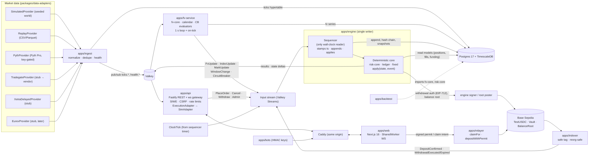
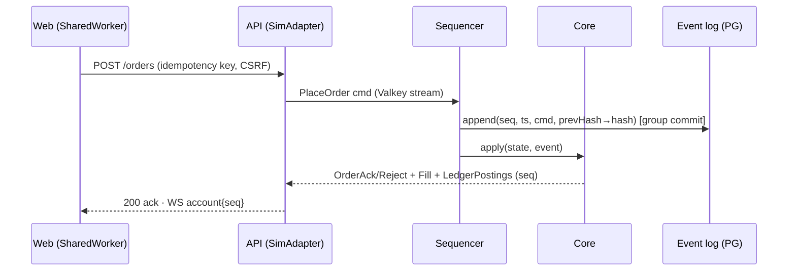
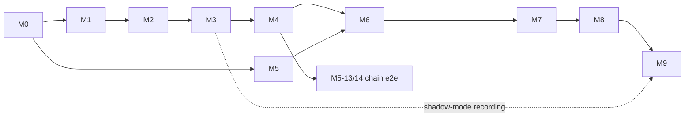

# EuroEdge — PLAN.md (v2)

> Status: **approved by founder 2026-10-27 ("go"). M0 complete; M1 complete on `integration/m1` (maths review pending, see `docs/milestones/m1.md`); M2 in progress.** v1 was the proposal; v2 records the founder's decisions (§0).
> Structure: §0 decision log · §1 understanding · §2 brief review · §3 architecture & data flows · §4 verified stack versions · §5 task breakdown M0–M9 (+ LR track) · §6 risks & unknowns · §7 ADR index · §8 open questions.

---

## 0. Decision log (founder answers, 2026-10-27)

**Process rules**

- **Review gate.** Any ADR or PR that changes the math in brief §6–§8 (FV, mark, funding, margin, ledger, contracts) needs the founder's **explicit review before merge**. These PRs carry the label `needs-founder-review`; see `CONTRIBUTING.md`.
- **Repo.** Work happens locally until the private repo `euroedge` is attached. M0 is pushed once it is. Each task gets its own branch, merged `--no-ff` into `main`, so the history maps 1:1 to PRs.

**Decisions**

| Topic                   | Decision                                                                                                                                                                                                                                                                                                                                                                                                                                                                                                        | Where        |
| ----------------------- | --------------------------------------------------------------------------------------------------------------------------------------------------------------------------------------------------------------------------------------------------------------------------------------------------------------------------------------------------------------------------------------------------------------------------------------------------------------------------------------------------------------- | ------------ |
| ADRs 001–015            | Accepted. ESLint 10, with 9 as fallback.                                                                                                                                                                                                                                                                                                                                                                                                                                                                        | `docs/adr/`  |
| live-min Window A index | No RT Xetra/Euronext licence for testnet. ADR-implied price counts only while the US session is live. Otherwise index = Tradegate mid, and FV is the sanity check via CB1. **Never a median of two values**; the two-source fallback is spelled out. Anchor `C` = official closing auction from the 15-min delayed feed. CB2 in live-min = Tradegate halt/volatility flag, **or** Tradegate silent > 60 s while the primary is scheduled open. Primary halts are detected with up to 15 min delay (documented). | ADR-008      |
| Band vs step cap        | The band dominates. Every clamp is an engine event. Mark pinned to a band edge > 60 s → that market "degraded" (no new opens) + alert (new **CB8**).                                                                                                                                                                                                                                                                                                                                                            | ADR-009      |
| Liquidation penalty     | 1 % (stocks), 0.5 % (baskets), 100 % to the insurance fund.                                                                                                                                                                                                                                                                                                                                                                                                                                                     | ADR-016      |
| House/insurance capital | At deploy, admin mints Test USDC **straight into the Vault**: 50,000,000 house + 5,000,000 insurance, with matching genesis ledger postings, so ledger and vault reconcile from block 0. **CB7:** house equity < 20 % of genesis **or** insurance < 20 % of genesis → global reduce-only. **Invariant 7:** Σ withdrawable user balances ≤ vault balance − house − insurance, checked on every event.                                                                                                            | ADR-013      |
| Contract granularity    | Fractional. Lot 0.01 share (stocks), 0.001 unit (baskets). Min notional €10.                                                                                                                                                                                                                                                                                                                                                                                                                                    | ADR-016      |
| Funding                 | Interest 5 % p.a., longs pay shorts, accrued per second, settled hourly (≈ 0.00057 %/h). Skew term linear, with `k` chosen so that \|netOIskew\| = OIcap hits exactly the window's hourly cap (A 0.03 %, B 0.02 %, C 0.01 %). Window D interest only. All in `windows.yaml`.                                                                                                                                                                                                                                    | ADR-016      |
| Dev login               | `DEV_LOGIN=true` only. CI fails if `DEV_LOGIN=true` and `DATA_TIER≠sim`. Never in any deployed build.                                                                                                                                                                                                                                                                                                                                                                                                           | M0-05, M0-10 |
| NOVO / SHEL (R4)        | Window A from the primary calendar (XCSE / XLON); Window B from the Tradegate calendar. Anchor `C` = primary closing auction → EUR at `t_C`. live-min price source stays the Tradegate EUR line. SHEL gets an optional XAMS EUR `priceSourceOverride` for later.                                                                                                                                                                                                                                                | ADR-017      |
| FX (R5)                 | Add EUR/GBP and EUR/DKK to live-min. DKK: static peg fallback 7.46, alert if the feed deviates > 0.5 % from the peg.                                                                                                                                                                                                                                                                                                                                                                                            | ADR-015      |
| Calendars (R6)          | Extended to 2028.                                                                                                                                                                                                                                                                                                                                                                                                                                                                                               | ADR-004      |
| Smart wallets (R7)      | Permit via OZ `SignatureChecker` (EOA + ERC-1271). Counterfactual (EIP-6492) wallets → EIP-5792 `wallet_sendCalls` batch (approve + deposit) sponsored by the CDP Paymaster.                                                                                                                                                                                                                                                                                                                                    | ADR-014      |
| WebSockets (R8)         | Caddy reverse proxy in dev (compose) and prod; one origin for web, api and ws.                                                                                                                                                                                                                                                                                                                                                                                                                                  | ADR-012      |
| live-min recording      | Starts as soon as a Tradegate feed exists, independent of the roadmap (track **LR**, §5).                                                                                                                                                                                                                                                                                                                                                                                                                       | §5           |
| Pyth coverage           | Stays on the to-verify list; the founder checks manually.                                                                                                                                                                                                                                                                                                                                                                                                                                                       | §6           |

**M0 review (founder, 2026-10-27)**

| Topic                                       | Decision                                                                                                                                                                                                                                            | Where             |
| ------------------------------------------- | --------------------------------------------------------------------------------------------------------------------------------------------------------------------------------------------------------------------------------------------------- | ----------------- |
| TypeScript 6.0.3                            | Accepted; revisit when typescript-eslint supports 7.                                                                                                                                                                                                | ADR-0011          |
| ESLint 10 without React/import/a11y plugins | Stay on 10. **Move a11y forward:** `@axe-core/playwright` in M1. axe runs on every existing page in CI and fails on serious/critical violations. Re-check plugin support at every milestone; re-enable `jsx-a11y` as soon as it supports ESLint 10. | ADR-0011, M1-20   |
| pnpm 24 h release-age rule                  | Keep.                                                                                                                                                                                                                                               | ADR-0011          |
| Hand-written shadcn components              | Accepted. Once the registry is reachable, diff against `shadcn add` output and reconcile.                                                                                                                                                           | ADR-0005          |
| `packages/db`, `packages/service-kit`       | Accepted.                                                                                                                                                                                                                                           | ADR-0011          |
| Invariant 7                                 | House equity = cash + uPnL at the latest mark event. **Full form:** Σ user equity (each floored at 0) + max(0, house equity) + insurance ≤ vault balance. **Separate invariants:** house equity ≥ 0, insurance ≥ 0.                                 | ADR-0013          |
| Funding cap                                 | Applies to the **total** rate (interest + skew), clamped after summing. Window D interest only, no skew cap.                                                                                                                                        | ADR-0016          |
| live-min, Tradegate stale in Window A       | Index = FV, market degraded (no new opens). **Escalation:** stale > 5 min while Window A is scheduled → that market reduce-only; released after 2 min of fresh quotes.                                                                              | ADR-0008          |
| CB7                                         | House equity includes uPnL. **Hysteresis:** triggers below 20 % of genesis, releases only above 30 % (house and insurance alike).                                                                                                                   | ADR-0013          |
| M1 deliverables                             | Screenshots of the bare terminal (dark/light × en/de) and a 5-line demo script. A replay test running a full simulated ASML trading day (windows A→D) that asserts all invariants and bit-for-bit replay.                                           | M1-21, M1-22      |
| Agent skills                                | Three reviewed skills vendored (`docs/research/skills-review.md`); `CLAUDE.md` sets precedence and overrides.                                                                                                                                       | `.claude/skills/` |

**Tooling found at M0 start** (ADR-011)

- TypeScript **6.0.3**, not 7.0: typescript-eslint 8.72 peers `typescript <6.1`.
- `ioredis` 6 instead of `iovalkey`: more mature and wire-compatible with Valkey.
- Node 24 native type stripping, so workspace packages export TS source and need no build step.
- Two small infra packages beyond the brief's layout: `packages/db` and `packages/service-kit`.

---

## 1. My understanding (10 lines)

1. EuroEdge is a **public testnet** venue for **USDC-settled, EUR-quoted quanto perps** on European single stocks and our own EU baskets, with play-money Test USDC on Base Sepolia.
2. The product's moat is the **fair-value engine**: a defensible 24/7 price for stocks whose primary venue trades ~8.5 h/day, built from Tradegate, US ADRs, FX (later Eurex), with explicit σ-bands.
3. Risk is **time-window-aware** (A primary open / B extended / C overnight / D weekend-holiday), resolved per market from its venue calendar, with ESMA-retail leverage caps on _new_ exposure and constant maintenance margin.
4. At the reopen the model **snaps** to the real auction; circuit breakers and reduce-only modes contain gaps, bad prints and stale feeds; the insurance fund absorbs shortfalls (no negative balances).
5. The **house is the sole counterparty** (quote-driven, not a CLOB): it quotes FV ± size/inventory/σ-dependent spread; our own flow never moves FV or mark, so a whale cannot liquidate others.
6. The core is a **single-writer, event-sourced, fixed-point engine** that never reads the wall clock; replay from the hash-chained log reproduces state bit-for-bit; a double-entry ledger enforces zero-sum invariants.
7. Collateral sits in an on-chain **Vault** (gasless claim/permit-deposit via relayer, EIP-712-signed withdrawals, hourly Merkle balance root); Test USDC is non-transferable so it can never acquire value.
8. Everything runs **without paid data** (`sim`/`replay`), switching to `live-min` (Tradegate RT + Pyth Pro ADRs + FX) by config; public launch, leaderboard and model-accuracy page require `live-min`.
9. A swappable **ExecutionAdapter** keeps the same UI/FV engine usable for step 2 (licensed partner's book) and step 3 (our own licensed MM); compliance hooks exist as interfaces, off by default.
10. Goal of step 1 is **evidence**: demand (waitlist, active traders) and model accuracy (overnight FV vs actual open, band coverage, toxic-flow cost) — delivered through a calm, best-in-class, institutional-grade terminal.

---

## 2. Brief review — things I believe are wrong, contradictory or under-specified

Per rule 15.5 I am not deviating silently; each item has a recommendation and is either an ADR (§7) or a question (§8).

> **v2 status:** R1–R9, R11, R13–R16 and R18 are resolved (see §0 / ADRs). R10, R12 and R17 are still open (§8).

| #   | Issue                                                                                                                                                                                                                                                                                                           | Recommendation                                                                                                                                                                                                                                                                           |
| --- | --------------------------------------------------------------------------------------------------------------------------------------------------------------------------------------------------------------------------------------------------------------------------------------------------------------- | ---------------------------------------------------------------------------------------------------------------------------------------------------------------------------------------------------------------------------------------------------------------------------------------- |
| R1  | **`live-min` has no real-time primary price.** §4.1 defines live-min as Tradegate RT + ADR + FX; Xetra is 15-min delayed. Yet Window A index/mark = `median{primary, Tradegate, FV}`, CB2 needs live volatility-interruption detection, and the anchor `C` needs the official closing auction.                  | ADR-008: in live-min, Window A uses `median{Tradegate mid, ADR-implied (when US open), FV}`, requires ≥2 fresh inputs else "degraded". CB2 is driven by Tradegate quote suspension + delayed-feed confirmation. `C` comes from the delayed/EOD official close (≈17:51 instead of 17:36). |
| R2  | **Mark step cap vs Invariant 5 conflict.** If FV legitimately jumps (e.g. news in Window B), a 50 bp/s cap keeps the mark outside the new `fvBand`, violating "mark always within fvBand except during SNAP".                                                                                                   | ADR-009: `mark = clamp(stepCapped(target), bandLo, bandHi)` — band dominates, step cap only smooths inside the band; every band-forced jump is logged as an event.                                                                                                                       |
| R3  | **House solvency vs vault invariant.** Ledger Σ = net deposits is fine, but if the house account goes negative, users' withdrawable claims exceed vault holdings (breaks the Foundry invariant "vault ≥ Σ withdrawable" economically).                                                                          | ADR-013: house and insurance fund are funded by real on-chain deposits from a house wallet (privileged `mintTo` → deposit, logged as `DepositConfirmed`); house balance must stay ≥ 0 (CB5 + top-up runbook). Need amounts (Q6).                                                         |
| R4  | **Override-line markets (NOVO, SHEL).** Which calendar defines the windows and the snap — Tradegate (08:00–22:00) or the primary listing (XCSE / XLON)? Tradegate has no closing auction for the anchor. Also **Shell plc has a EUR line on Euronext Amsterdam**, which may be a better primary than Tradegate. | Windows/snap from the primary listing (XCSE 09:00–17:00, XLON 08:00–16:30 UK); anchor = primary close converted at `t_C`; Tradegate EUR line = live signal. Consider XAMS as SHEL's EUR primary (Q10).                                                                                   |
| R5  | **FX coverage.** GBX and DKK conversions need EUR/GBP and EUR/DKK; live-min only lists EUR/USD.                                                                                                                                                                                                                 | Add EURGBP, EURDKK (DKK is pegged but still convert from a feed; the sim uses a peg band). Confirm Pyth Pro coverage.                                                                                                                                                                    |
| R6  | **Calendars 2026–27 are too short.** At ~45 pw the public launch lands in 2027-H2; data must cover 2028.                                                                                                                                                                                                        | Curate 2026–2028; CI fails 120 days before calendar data runs out (ADR-004).                                                                                                                                                                                                             |
| R7  | **Smart wallets can't use OZ `ERC20Permit`.** OZ's permit is ECDSA-only (no ERC-1271), and Coinbase Wallet is often a smart wallet.                                                                                                                                                                             | ADR-014: add an ERC-1271-aware `permit` (OZ `SignatureChecker`) to TestUSDC, plus a CDP-Paymaster fallback (`approve` + `deposit` sponsored).                                                                                                                                            |
| R8  | **WebSockets through Next.js rewrites** are unreliable for upgrades.                                                                                                                                                                                                                                            | ADR-012: same-origin routing via **Caddy** (`/api/*`, `/ws` → api; rest → web) in compose and prod; cookies stay same-site with no CORS.                                                                                                                                                 |
| R9  | **"Liquidation penalty" vs "liquidation fee"** — §7.1 fills liquidations at `mark ∓ penalty`; §7.2 sends "the liquidation fee" to insurance.                                                                                                                                                                    | Treat as one parameter: the penalty is charged to the liquidated account and posted to insurance; the house fills at mark. Need the value (Q5).                                                                                                                                          |
| R10 | **Window D stock leverage "2x or reduce-only"** is ambiguous.                                                                                                                                                                                                                                                   | Per-market config `windowD.mode: lev2                                                                                                                                                                                                                                                    | reduceOnly`; default `lev2`, `reduceOnly` for markets without any off-hours anchor (RHM). Q11. |
| R11 | **CB4 "−7 % intraday"** has no reference price.                                                                                                                                                                                                                                                                 | Measure vs the basket's current anchor `C` (prior official close); reset at the anchor update.                                                                                                                                                                                           |
| R12 | **Leaderboard "fixed starting balance, no top-ups"** conflicts with a single vault balance per wallet.                                                                                                                                                                                                          | Season = separate engine sub-account funded from a season allocation at opt-in; deposits into it are blocked mid-season (M8, Q-later).                                                                                                                                                   |
| R13 | "Gitcoin Passport" was rebranded **Human Passport** (2025).                                                                                                                                                                                                                                                     | Use Human Passport API, behind a `SybilCheck` interface.                                                                                                                                                                                                                                 |
| R14 | Brief says ESLint 9; **ESLint 10 is current stable** (10.0 released Feb 2026; `eslint-config-next` peer is `>=9`).                                                                                                                                                                                              | ADR-011: ESLint 10 flat config + Prettier. Fall back to 9 if a plugin lags.                                                                                                                                                                                                              |
| R15 | "Lightweight Charts accessibility plugin": I could not confirm that an official plugin exists in 5.2.                                                                                                                                                                                                           | Verify in M7-13; if absent, build our own (keyboard crosshair + summarised `aria-live` + hidden data table).                                                                                                                                                                             |
| R16 | The `safe` block tag on Base Sepolia lags minutes behind head (L1 batch posting).                                                                                                                                                                                                                               | Keep `safe` per brief; the UI shows "Deposit pending (≈2–5 min)" with the tx link.                                                                                                                                                                                                       |
| R17 | Resting limits fill **at the limit** when the house quote crosses, so on a gap the improvement goes to the house.                                                                                                                                                                                               | Fine for v1 (documented in the contract specs). The cross is tested with the executable price **for the order's full size**; no partial fills for resting orders in v1 (Q-later).                                                                                                        |
| R18 | A weekly window for the US session: brief says "15:30–22:00 CET"; during DST-mismatch weeks (incl. **this week**, 26–30 Oct 2026) it is 14:30–21:00 CET.                                                                                                                                                        | Already handled by deriving windows from per-venue calendars, never from fixed CET strings. Copy uses derived times.                                                                                                                                                                     |

---

## 3. Architecture

### 3.1 System diagram

**Key boundaries**

- **Floats stop at fv-core.** fv-service quantizes FV/band/index/mark to integer ticks before emitting engine events. The engine consumes logged values; replay never recomputes FV.
- **Only the sequencer reads the clock.** It stamps `ts` on each input, appends it to the log (group commit ≤ 5 ms), then applies. The core is a pure reducer. Inputs are logged, outputs are derived.
- **The API only talks to `ExecutionAdapter`.** `SimAdapter` wraps the engine command stream; `PartnerAdapter`/`OwnVenueAdapter` are stubs.

### 3.2 Order lifecycle

### 3.3 Data flow per window (per market; window boundaries come from that market's venue calendars)

|                   | **A – primary open**                                                                                                                          | **B – extended**                                                     | **C – overnight**                                                             | **D – weekend / holiday**                       |
| ----------------- | --------------------------------------------------------------------------------------------------------------------------------------------- | -------------------------------------------------------------------- | ----------------------------------------------------------------------------- | ----------------------------------------------- |
| FV signals        | Tradegate (spread < 30 bp, age < 60 s); ADR when the US regular session overlaps; futures later                                               | Tradegate; ADR during US regular/extended                            | ADR on US overnight venue if covered (Pyth Pro TBC); futures later; else none | none                                            |
| FV when no signal | –                                                                                                                                             | –                                                                    | `FV_last`, `σ² += q_C·Δt`                                                     | `FV_last`, `σ² += q_D·Δt`                       |
| Index             | `median{primary, TG, FV}` (sim/replay). live-min (ADR-008): US live → `median{TG, ADR-implied, FV}`; otherwise TG mid (FV = CB1 sanity check) | FV                                                                   | FV                                                                            | FV_last                                         |
| Mark              | same as index, then step-capped and **clamped to fvBand** (ADR-009; each clamp = event; pinned > 60 s → CB8)                                  | FV (step cap, band clamp)                                            | FV                                                                            | FV_last (flat)                                  |
| Engine params     | 5x / 10x, ±10 %, 5/1 bp                                                                                                                       | 4x / 10x, ±5 %, 8/2 bp                                               | 3x / 8x, ±4 %, 12/3 bp                                                        | 2x or RO / 5x, ±min(3 %, 1/lev), 20/5 bp + skew |
| Transition        | → B at the close auction; `C` updated when the official close arrives                                                                         | → C at 22:00/23:00; → A through **PRE_OPEN → AUCTION → SNAP → OPEN** | → B at 08:00 Tradegate open                                                   | → B Monday 08:00 (or the next trading day)      |

### 3.4 Data flow per tier

|                             | `sim` (default)                             | `replay`         | `live-min` (public launch)                                                                                               |
| --------------------------- | ------------------------------------------- | ---------------- | ------------------------------------------------------------------------------------------------------------------------ |
| Primary (XETR/XAMS/XPAR/…)  | simulated RT incl. auctions                 | recorded         | **delayed 15 min / EOD official prints only** (licence TBC)                                                              |
| Tradegate                   | simulated                                   | recorded         | real-time via vendor (TBD)                                                                                               |
| US ADRs (+ overnight)       | simulated                                   | recorded         | Pyth Pro                                                                                                                 |
| FX (EURUSD, EURGBP, EURDKK) | simulated                                   | recorded         | Pyth Pro (coverage TBC); DKK peg fallback 7.46                                                                           |
| Anchor `C`                  | sim closing auction                         | recorded close   | official closing auction from the 15-min delayed feed                                                                    |
| CB2 (primary halt)          | sim halt flag                               | recorded         | Tradegate halt/vol flag, or Tradegate silent > 60 s while primary scheduled open (real primary halts seen ≤ 15 min late) |
| Snap source                 | sim opening-auction print                   | recorded auction | Tradegate 1st-minute VWAP after the primary open → reconciled with the delayed official open (~+15 min)                  |
| UI                          | "SIMULATED PRICES" watermark on every price | watermark        | no watermark; "model price" labels off-hours                                                                             |
| Leaderboard / accuracy page | disabled                                    | disabled         | enabled                                                                                                                  |
| Raw ticks to users          | n/a                                         | n/a              | only where `redistributionAllowed: true`; otherwise derived index/mark/FV only                                           |

**Recommendation:** record live-min data in **shadow mode** as soon as a Tradegate feed exists, even before M9. The public accuracy page needs ≥ 4–8 weeks of real overnight-vs-open history. That is calendar time and cannot be compressed.

### 3.5 Milestone dependencies

---

## 4. Stack versions (verified on npm / nodejs.org, 2026-10-27)

| Package                                     | Current                                           | Plan                                                                               |
| ------------------------------------------- | ------------------------------------------------- | ---------------------------------------------------------------------------------- |
| Node                                        | 24.22.x LTS "Krypton"; 26.x is about to enter LTS | **Node 24 LTS** per brief (maintenance until Apr 2028); revisit 26 via ADR in 2027 |
| pnpm / turbo                                | 12.15 / 2.11                                      | pin via `packageManager` + corepack                                                |
| next / react                                | 16.4.3 / 19.3.1                                   | as brief                                                                           |
| tailwindcss                                 | 4.3.3                                             | ✔                                                                                  |
| @base-ui/react / shadcn CLI                 | 1.9.0 / 4.23                                      | ✔ (ADR-005)                                                                        |
| **wagmi**                                   | **3.7.9 latest**, 2.19.5 on v2                    | **wagmi 2.19.x** — RainbowKit 2.2.11 still peers `wagmi ^2.9.0` (ADR-006)          |
| viem / RainbowKit                           | 2.57 / 2.2.11                                     | ✔                                                                                  |
| lightweight-charts                          | 5.2.1                                             | ✔                                                                                  |
| zod / fastify / ws                          | 4.6 / 5.12 / 8.22                                 | ✔                                                                                  |
| vitest / playwright / fast-check            | 5.0 / 1.64 / 4.10                                 | ✔                                                                                  |
| eslint                                      | **10.13**                                         | ADR-011                                                                            |
| typescript                                  | **7.0.2** latest (native port)                    | **6.0.3** — typescript-eslint 8.72 peers `<6.1` (ADR-011)                          |
| ioredis                                     | 6.0.0                                             | used against Valkey (ADR-010)                                                      |
| OZ contracts / merkle-tree                  | 5.6.1 / 1.0.8                                     | ✔                                                                                  |
| motion / react-resizable-panels / next-intl | 14.7 / 4.15 / 4.14                                | ✔                                                                                  |
| Postgres + Timescale                        | PG 17 per brief (PG 18 exists)                    | PG 17 + current Timescale 2.x                                                      |
| Redis/Valkey                                | —                                                 | Valkey 8 (ADR-010)                                                                 |

Exact pins go into `docs/versions.md` at M0-01, re-verified at install time.

---

## 5. Task breakdown M0–M9

Each task is ≤ 1 day / ≤ ~400 LOC diff and becomes one PR on its own branch. Estimates are **senior-engineer days (d)**. "Dep" refers to task IDs within the milestone unless prefixed.

### M0 — Scaffold, CI, infra (≈ 8 d)

| ID    | Task                                                                                                                                                                                                                 | d   | Dep   |
| ----- | -------------------------------------------------------------------------------------------------------------------------------------------------------------------------------------------------------------------- | --- | ----- |
| M0-01 | Repo bootstrap: pnpm workspaces, Turborepo, strict `tsconfig.base`, Node 24 pin, `packageManager`; `docs/versions.md`                                                                                                | 0.5 | –     |
| M0-02 | ESLint 10 flat + Prettier, commitlint, lefthook; **determinism lint** (ban `Date`, `Math.random`, `number` literals for money, `setTimeout` in core packages)                                                        | 0.5 | 01    |
| M0-03 | Vitest workspace, fast-check, coverage thresholds                                                                                                                                                                    | 0.5 | 01    |
| M0-04 | docker-compose: PG17+Timescale, Valkey, Caddy (single origin), anvil placeholder; healthchecks; `packages/db` (Kysely + plain-SQL migrations)                                                                        | 1   | 01    |
| M0-05 | `packages/shared`: zod-4 config loader (env + YAML), `DATA_TIER`, `DEV_LOGIN` runtime guard (refuses unless `DATA_TIER=sim`), complete `.env.example`                                                                | 1   | 03    |
| M0-06 | `packages/fixed`: branded bigint types (Usdc 1e6, Ticks, Lots, Bps, Rate1e18), rounding modes, mulDiv                                                                                                                | 1   | 03    |
| M0-07 | `packages/fixed`: tick/lot/tickValue conversions, fee helpers, property tests                                                                                                                                        | 0.5 | 06    |
| M0-08 | `packages/service-kit` + service skeletons (engine, fv-service, ingest, api, relayer, indexer, bots, backtest): pino, `/health`, graceful shutdown, `pnpm dev`                                                       | 1   | 05    |
| M0-09 | `apps/web` skeleton: Next 16, Tailwind 4.3, shadcn on Base UI, next-intl en/de, themes, testnet banner, `packages/ui` tokens v0                                                                                      | 1   | 01    |
| M0-10 | GitHub Actions: lint · typecheck · test · build with service containers, dependency audit, turbo cache, Foundry placeholder; **env guard** (fails if `DEV_LOGIN=true` with `DATA_TIER≠sim`, or in any deploy config) | 1   | 02–09 |
| M0-11 | MADR template; ADRs 001–017 into `docs/adr/`; README (Mermaid), CHANGELOG, CONTRIBUTING (review gate), PR template                                                                                                   | 0.5 | 01    |

### M1 — Thin vertical slice: ASML, sim, dev login (≈ 16.5 d)

| ID    | Task                                                                                                                                      | d   | Dep    |
| ----- | ----------------------------------------------------------------------------------------------------------------------------------------- | --- | ------ |
| M1-01 | Shared schemas: `Tick`, `InstrumentRef`, `MarketConfig`; `markets.yaml` ASML entry                                                        | 0.5 | M0     |
| M1-02 | Interim hard-coded XAMS/TGAT/XNAS sessions → A/B/C/D for ASML (replaced in M2)                                                            | 0.5 | 01     |
| M1-03 | SimulatedProvider v0: seeded GBM for ASML (XAMS trades/quotes, Tradegate quotes, Nasdaq ASML, EURUSD), deterministic PRNG                 | 1   | 01     |
| M1-04 | Ingest v0: provider → Valkey pub/sub + `ticks` hypertable (batched)                                                                       | 1   | 03     |
| M1-05 | fv-core v0: `s_T`, `s_A` (no basis), inverse-variance combo, σ floor, band, tick quantization; unit + property tests                      | 1   | M0-07  |
| M1-06 | fv-service v0: 1 s loop + on-tick, sim anchor, emits FvUpdate/Index/Mark events, FV hypertable                                            | 1   | 04, 05 |
| M1-07 | Event envelope + canonical encoding (JCS, bigint as string) + sha256 hash chain; tests                                                    | 1   | M0-06  |
| M1-08 | Event store: append-only PG table (raw canonical bytes), group commit, read-from-seq, advisory-lock single writer                         | 1   | 07     |
| M1-09 | Sequencer: Valkey Streams consumer, ts stamping, ClockTick timer, apply loop, result publishing                                           | 1   | 08     |
| M1-10 | `packages/ledger` v0: accounts, balanced postings, projections, runtime asserts, property tests                                           | 1   | M0-07  |
| M1-11 | `risk-core` v0: position, avg entry, quanto uPnL, equity, IM/MM (5x/10 %), cross margin                                                   | 1   | 10     |
| M1-12 | Engine core v0: DevDeposit, market order vs house at FV ± fixed half-spread, close, MarkUpdate                                            | 1   | 09, 11 |
| M1-13 | Invariant harness: fast-check model test (10k steps) for invariants 1, 2, 4 + replay == live                                              | 1   | 12     |
| M1-14 | `packages/execution`: `ExecutionAdapter` + `SimAdapter`                                                                                   | 0.5 | 12     |
| M1-15 | API v0: dev login (sim only, flag-gated), `POST /orders`, `GET /account`, WS `fv.ASML-PERP` + `account`                                   | 1   | 14     |
| M1-16 | Web v0: terminal page with mark/FV/band, watermark, LW Charts mark + band, market ticket, positions + close                               | 1   | 15     |
| M1-17 | Web v0: WS hook, dev login, disclaimers                                                                                                   | 0.5 | 16     |
| M1-18 | Playwright smoke in CI: login → open → close against the compose stack                                                                    | 1   | 17     |
| M1-19 | M1 report + README run instructions                                                                                                       | 0.5 | 18     |
| M1-20 | `@axe-core/playwright` on every existing page in CI (fail on serious/critical); skip link, `theme-color`, `translate="no"` (design notes) | 0.5 | 18     |
| M1-21 | Full simulated ASML trading day (A→B→C→D) replay test: all invariants + bit-for-bit replay + hash chain                                   | 1   | 13     |
| M1-22 | Screenshots (dark/light × en/de) + 5-line demo script                                                                                     | 0.5 | 20     |

### M2 — Calendars, providers, all markets (≈ 17.5 d)

| ID    | Task                                                                                                                                                                                   | d   | Dep    |
| ----- | -------------------------------------------------------------------------------------------------------------------------------------------------------------------------------------- | --- | ------ |
| M2-01 | Calendar YAML schema (sessions, auctions with random-end ranges, half-days, holidays, tz, source URLs) + loader                                                                        | 1   | M1     |
| M2-02 | Curate XETR + TGAT (+ L&S hours) 2026–2028                                                                                                                                             | 1   | 01     |
| M2-03 | Curate XAMS, XPAR, XCSE, XLON 2026–2028                                                                                                                                                | 1   | 01     |
| M2-04 | Curate XNYS/XNAS (+ overnight venue session), XEUR, FX 24/5 2026–2028                                                                                                                  | 1   | 01     |
| M2-05 | Venue state resolver (closed/pre-open/auction/continuous/post/halted) + next transitions (Luxon)                                                                                       | 1   | 02–04  |
| M2-06 | Per-market window resolver, next change, 24 h ribbon segments                                                                                                                          | 1   | 05     |
| M2-07 | Calendar tests: DST mismatch 26–30 Oct 2026 & 14–28 Mar 2027, holidays, half-days, partition property; cross-check vs `exchange_calendars` export                                      | 1   | 06     |
| M2-08 | Halt state from feed silence + provider health                                                                                                                                         | 0.5 | 05     |
| M2-09 | Sim world v1: correlated GBM + jumps + sector factors for 10 markets + basket constituents + ADRs                                                                                      | 1   | 05     |
| M2-10 | Sim v1: venue-aware emission, auctions (indicative + final), gaps, US overnight                                                                                                        | 1   | 09     |
| M2-11 | Sim v1: dividends (separate local/ADR ex-dates), EURUSD/EURGBP/EURDKK (DKK peg fallback 7.46 + > 0.5 % deviation alert), GBX/DKK lines                                                 | 1   | 10     |
| M2-12 | Sim v1: seeded fault injection (bad prints, stale feeds, halts) + scenario DSL                                                                                                         | 1   | 10     |
| M2-13 | `docs/data-format.md`, CSV writer, committed `data/sample/` (2 weeks incl. DST week, holiday, ex-div)                                                                                  | 1   | 11, 12 |
| M2-14 | ReplayProvider (CSV + Parquet), 1–1000× virtual clock                                                                                                                                  | 1   | 13     |
| M2-15 | PythProvider (key-gated, never called without a key), symbol map, recorded-fixture tests                                                                                               | 1   | M1     |
| M2-16 | Stubs: Tradegate, XetraDelayed, Eurex; provider registry per tier; `redistributionAllowed` + attribution                                                                               | 0.5 | 15     |
| M2-17 | `markets.yaml` for all 10 markets + basket definitions; ADR ratios with `verified` flags; NOVO/SHEL window sources per ADR-017 (SHEL optional XAMS override); provider health → status | 1   | 16     |
| M2-18 | Ingest v1: all providers, normalization (GBX/100, ccy), dedupe, compression/retention policies                                                                                         | 1   | 17     |

### M3 — Full fv-core, backtest, golden vectors (≈ 17.5 d)

| ID    | Task                                                                                                                                                                                                                                    | d   | Dep    |
| ----- | --------------------------------------------------------------------------------------------------------------------------------------------------------------------------------------------------------------------------------------- | --- | ------ |
| M3-01 | Anchor manager: per-tier close source, override lines, FX at `t_C`, "previous anchor until published"                                                                                                                                   | 1   | M2     |
| M3-02 | Dividend adjustment per venue line                                                                                                                                                                                                      | 0.5 | 01     |
| M3-03 | ADR signal with EWMA basis `b_A`, FX normalization, unverified → weight 0                                                                                                                                                               | 1   | 01     |
| M3-04 | Tradegate filters; generic `v_k = σ_k² + λ·age`                                                                                                                                                                                         | 0.5 | 01     |
| M3-05 | Combination with φ, `σ_floor[window]`, no-signal widening; property tests                                                                                                                                                               | 1   | 03, 04 |
| M3-06 | Confidence classes, sources/weights/ages output, boundary quantization                                                                                                                                                                  | 0.5 | 05     |
| M3-07 | Index & mark per window/tier incl. live-min source table (ADR-008); step cap + band clamp, `MarkClamped` events, pinned > 60 s → CB8 (ADR-009)                                                                                          | 1   | 06     |
| M3-08 | Snap state machine, per-tier snap source, no indicative prints, band re-centre, cap suspension, outside-band flag                                                                                                                       | 1   | 07     |
| M3-09 | Snap tests incl. live-min VWAP → delayed reconciliation                                                                                                                                                                                 | 1   | 08     |
| M3-10 | Basket FV: weights, divisor, drop + renormalize with events                                                                                                                                                                             | 1   | 06     |
| M3-11 | EWMA covariance estimator → basket σ_FV (no independence assumption)                                                                                                                                                                    | 1   | 10     |
| M3-12 | Pure CB evaluators: CB1 divergence, CB2 (live-min: TG halt flag / TG silent > 60 s while primary open), CB3 staleness + TG-stale escalation (> 5 min → RO, release after 2 min fresh), CB4 basket drawdown, CB8 pinned mark; CB6 inputs | 1   | 07     |
| M3-13 | fv-service v1: all markets/windows, CB + window-change events, persistence                                                                                                                                                              | 1   | 08–12  |
| M3-14 | Backtest CLI: replay → FV at each open; MAE/RMSE bp vs next open; naive-close baseline                                                                                                                                                  | 1   | 13     |
| M3-15 | Backtest metrics: band coverage, PIT histogram, p99.9, per-window split; JSON schema                                                                                                                                                    | 1   | 14     |
| M3-16 | Parameter fitting (σ_k, λ, φ, q, basis half-life)                                                                                                                                                                                       | 1   | 15     |
| M3-17 | Golden-vector format + runner (FV, funding, liq price, fees); placeholders until the spreadsheet arrives                                                                                                                                | 1   | 06     |
| M3-18 | Public methodology v1 (FV + baskets)                                                                                                                                                                                                    | 1   | 16     |

### M4 — Full engine, bots, stress (≈ 28.5 d)

| ID    | Task                                                                                                                                                                                  | d   | Dep   |
| ----- | ------------------------------------------------------------------------------------------------------------------------------------------------------------------------------------- | --- | ----- |
| M4-01 | `windows.yaml` schema/loader; ParamChange events                                                                                                                                      | 0.5 | M3    |
| M4-02 | Quote model (ADR-003): half-spread f(window, σ, inventory, size), convex impact, ladder, house-favourable rounding                                                                    | 1   | 01    |
| M4-03 | Capped flow shift `κ·netFlow` with per-wallet event-time rate limit                                                                                                                   | 1   | 02    |
| M4-04 | Resting-order store + deterministic trigger evaluation on mark/quote                                                                                                                  | 1   | 02    |
| M4-05 | Market, marketable limit, IOC/FOK, priceLimit vs index                                                                                                                                | 1   | 04    |
| M4-06 | Resting limit (fill at limit, maker fee), post-only, GTC, cancel/replace, client IDs, idempotency                                                                                     | 1   | 05    |
| M4-07 | Stop-market, stop-limit, TP/SL (OCO) on mark, reduce-only                                                                                                                             | 1   | 06    |
| M4-08 | Margin checks: window caps on new exposure, OI caps, earnings add-on / leverage step, basket vs stock                                                                                 | 1   | 05    |
| M4-09 | Fees per window (+ D skew add-on), rounding up, residue routing                                                                                                                       | 0.5 | 05    |
| M4-10 | Funding per ADR-016: per-second interest (5 % p.a., longs pay), linear skew term reaching the window cap at \|skew\| = OIcap, hourly settlement, D interest-only, `quantoDrift` field | 1   | 08    |
| M4-11 | Funding zero-sum property tests + golden vectors                                                                                                                                      | 0.5 | 10    |
| M4-12 | Liquidations: partial → full, penalty 1 % / 0.5 % → 100 % insurance, house fill, negative-balance protection                                                                          | 1   | 08    |
| M4-13 | Snap-period liquidation (3-min VWAP), outside-band reduce-only 5 min                                                                                                                  | 1   | 12    |
| M4-14 | House risk: inventory cap → one-sided → RO, daily loss limit, σ widening                                                                                                              | 1   | 02    |
| M4-15 | CB application in the engine (no-opens / RO / freeze / global); CB5 and **CB7** (trigger < 20 %, release > 30 % of genesis) evaluators                                                | 1   | 14    |
| M4-16 | Dividend cash flows (net long / gross short, withholding config)                                                                                                                      | 0.5 | 10    |
| M4-17 | Corporate actions: freeze → ratio adjust → unfreeze (admin events)                                                                                                                    | 1   | 15    |
| M4-18 | Withdrawal reservation state machine (`vault-pending`) — logic only                                                                                                                   | 1   | 12    |
| M4-19 | Snapshots every N events, restore, snapshot-vs-genesis equality, hash-chain verifier CLI                                                                                              | 1   | –     |
| M4-20 | Event schema versioning + upcasters                                                                                                                                                   | 0.5 | 19    |
| M4-21 | Full invariant suite (1–9: incl. Invariant 7 solvency, house equity ≥ 0, insurance ≥ 0, each on every event) over 10k+ random steps, all event types                                  | 1   | 01–20 |
| M4-22 | Read-model projections (positions/orders/fills/funding) + hot-state publishing                                                                                                        | 1   | 21    |
| M4-23 | Bot framework: HMAC client, scheduler, 200-account bootstrap                                                                                                                          | 1   | 22    |
| M4-24 | Bots: noise, momentum, mean-reversion                                                                                                                                                 | 1   | 23    |
| M4-25 | Informed arbitrageur + PnL per €1M OI                                                                                                                                                 | 1   | 23    |
| M4-26 | Whale bot + "cannot trigger liquidations" assertion                                                                                                                                   | 1   | 23    |
| M4-27 | Stress scenarios: Monday −10 % gap, bad print, feed outage, DST week, ex-div day                                                                                                      | 1   | 24–26 |
| M4-28 | Perf: 50 orders/s sustained, p99 ack < 50 ms; CI benchmark (non-blocking)                                                                                                             | 1   | 27    |
| M4-29 | Backtest: false-liquidation rate + toxic-flow cost through risk-core                                                                                                                  | 1   | 25    |
| M4-30 | `AdlPolicy` stub; §13 compliance interfaces behind flags + leverage-table switch tests                                                                                                | 1   | 08    |

### M5 — Contracts, relayer, indexer, Base Sepolia (≈ 13.5 d; M5-01…12 can run in parallel with M1–M4)

| ID    | Task                                                                                                                                                                      | d   | Dep       |
| ----- | ------------------------------------------------------------------------------------------------------------------------------------------------------------------------- | --- | --------- |
| M5-01 | Foundry + OZ 5.6, CI job, Slither                                                                                                                                         | 0.5 | M0        |
| M5-02 | TestUSDC: restricted transfers, claim caps (24 h + lifetime), `claimFor` (EIP-712), `SignatureChecker` permit (EOA + 1271, ADR-014), admin genesis mint → Vault (ADR-013) | 1   | 01        |
| M5-03 | Vault: `deposit`, `depositWithPermit`, events                                                                                                                             | 1   | 02        |
| M5-04 | Vault: EIP-712 `withdraw`, nonce bitmap, deadline, daily limit, multisig pause                                                                                            | 1   | 03        |
| M5-05 | Foundry invariants (vault ≥ Σ withdrawable; nonce non-reuse) + fuzz                                                                                                       | 1   | 04        |
| M5-06 | BalanceRoot + tests                                                                                                                                                       | 0.5 | 01        |
| M5-07 | Deploy scripts, `deployments/84532.json`, Basescan verification, Safe setup doc                                                                                           | 1   | 05, 06    |
| M5-08 | Engine signer service (separate key, KMS-ready interface)                                                                                                                 | 1   | M4-18     |
| M5-09 | Indexer: `safe`-tag polling, cursor, idempotent reorg handling → engine events                                                                                            | 1   | 07        |
| M5-10 | Indexer: withdrawal-expiry confirmation → re-credit; anvil reorg tests                                                                                                    | 1   | 09        |
| M5-11 | Relayer: claimFor + depositWithPermit, nonce mgmt, per-wallet/IP rate limits, ETH balance alerts                                                                          | 1   | 07        |
| M5-12 | Hourly Merkle root poster + proofs API                                                                                                                                    | 1   | 06, M4-19 |
| M5-13 | Local anvil e2e: claim → deposit → trade → withdraw                                                                                                                       | 1   | 08–12     |
| M5-14 | Base Sepolia deploy + live acceptance run + runbook                                                                                                                       | 1   | 13        |
| M5-15 | Counterfactual (6492) wallets: EIP-5792 `wallet_sendCalls` approve + deposit, CDP Paymaster sponsorship (ADR-014)                                                         | 1   | 11        |

### M6 — API complete (≈ 13.5 d)

| ID    | Task                                                                                                                 | d   | Dep |
| ----- | -------------------------------------------------------------------------------------------------------------------- | --- | --- |
| M6-01 | SIWE: single-use nonce (5 min TTL), `verifySiweMessage`, domain/URI/chainId binding, session cookie; 1271/6492 tests | 1   | M4  |
| M6-02 | CSRF tokens, Origin policy, Caddy same-origin routing                                                                | 1   | 01  |
| M6-03 | HMAC API keys for bots                                                                                               | 0.5 | 01  |
| M6-04 | REST: markets, market detail, status                                                                                 | 1   | 02  |
| M6-05 | REST: candles (continuous aggregates), FV series with band                                                           | 1   | 04  |
| M6-06 | REST: account, positions, orders, fills, funding (adapter only)                                                      | 1   | 04  |
| M6-07 | Rate limits (IP + wallet), request IDs, structured errors                                                            | 0.5 | 02  |
| M6-08 | OpenAPI from zod + typed client in `packages/shared`                                                                 | 1   | 06  |
| M6-09 | WS: cookie + Origin upgrade auth, channel registry                                                                   | 1   | 02  |
| M6-10 | WS protocol: per-channel seq, snapshot-on-subscribe, heartbeat, gap → resync, conflation                             | 1   | 09  |
| M6-11 | Channels: ticker, quotes, fv, trades, account (engine seq), status                                                   | 1   | 10  |
| M6-12 | Shared WS client SDK (web + bots): reconnect, resync, typed messages                                                 | 1   | 11  |
| M6-13 | Load test: 500 clients; gap/resync tests                                                                             | 1   | 12  |
| M6-14 | Leaderboard / accuracy endpoints (tier-gated)                                                                        | 0.5 | 04  |
| M6-15 | Admin API: allowlisted wallets → engine admin events                                                                 | 1   | 01  |

### M7 — Trade terminal (≈ 28 d)

| ID    | Task                                                                                                              | d   | Dep   |
| ----- | ----------------------------------------------------------------------------------------------------------------- | --- | ----- |
| M7-01 | Finalize UI-benchmark ADR from screenshots; tokens (CB-safe colour schemes, type, spacing, motion)                | 1   | M6    |
| M7-02 | Primitives: ref-updated numeric cells, ▲▼ price, data-age badge, session pill, tooltips                           | 1   | 01    |
| M7-03 | SharedWorker WS + dedicated-worker fallback; rAF-batched external store                                           | 1   | M6-12 |
| M7-04 | Resizable layout, presets (Trader/Compact/Analyst), saved layouts, breakpoints                                    | 1   | 02    |
| M7-05 | Top bar (mark, 24 h, pill, funding countdown, OI)                                                                 | 0.5 | 03    |
| M7-06 | ⌘K market selector (name/ticker/ISIN, filters, favourites, mini pills)                                            | 1   | 05    |
| M7-07 | Session ribbon (24 h segments, now marker, countdown, leverage step-down, DST-aware hover)                        | 1   | 05    |
| M7-08 | Price-provenance popover + transparency strip                                                                     | 1   | 05    |
| M7-09 | Chart: mark candles, timeframes, volume, VWAP                                                                     | 1   | 03    |
| M7-10 | Chart: FV fan (custom series, gradient band)                                                                      | 1   | 09    |
| M7-11 | Chart: window shading, snap markers, ex-div/earnings markers                                                      | 1   | 10    |
| M7-12 | Chart trading: draggable limit/TP/SL with a keyboard/click alternative (WCAG 2.5.7), position + liquidation lines | 1   | 11    |
| M7-13 | Click-to-trade popover; chart accessibility (R15)                                                                 | 1   | 12    |
| M7-14 | Quote ladder (€1k/5k/25k/100k, depth curve, own orders, liq markers)                                              | 1   | 03    |
| M7-15 | Order ticket: side, types, size modes, shared-zod validation                                                      | 1   | 03    |
| M7-16 | Ticket: window-capped leverage slider + explanation, TP/SL, RO/PO, fee/fill/funding estimates                     | 1   | 15    |
| M7-17 | Pre-trade risk card (liq price, σ distance, ESMA close-out, gap slider, next-window warning)                      | 1   | 16    |
| M7-18 | Hotkeys + remapping + **switch-off** (WCAG 2.1.4) + `?` cheat sheet                                               | 0.5 | 16    |
| M7-19 | Positions table (virtualised, margin bar, close/partial, TP/SL edit, next-window highlight)                       | 1   | 03    |
| M7-20 | Orders, history, fills, funding, account tabs                                                                     | 1   | 19    |
| M7-21 | Basket constituent heatmap                                                                                        | 1   | 03    |
| M7-22 | Morning report card                                                                                               | 0.5 | 03    |
| M7-23 | Toasts + inbox (fills, liq, 30-min window warning, CBs)                                                           | 1   | 03    |
| M7-24 | RainbowKit connect + SIWE + network switch                                                                        | 1   | M6-01 |
| M7-25 | Compliance UI: banner, ESMA block (`losingAccountsPct`), model-price labels, watermark, attributions, LW NOTICE   | 0.5 | 02    |
| M7-26 | de strings for the terminal; locale numbers/dates; tz labels                                                      | 0.5 | 20    |
| M7-27 | A11y: throttled `aria-live`, keyboard flow, reduced motion, axe in Playwright                                     | 1   | 20    |
| M7-28 | Perf: < 200 KB shell budget in CI, Cache Components shell, 60 fps profiling                                       | 1   | 20    |
| M7-29 | Playwright e2e (wagmi `mock` connector): SIWE → trade → close; visual snapshots                                   | 1   | 24    |
| M7-30 | Lighthouse CI ≥ 90                                                                                                | 0.5 | 28    |

### M8 — Remaining pages, mobile, i18n (≈ 19.5 d)

| ID    | Task                                                                                               | d   | Dep   |
| ----- | -------------------------------------------------------------------------------------------------- | --- | ----- |
| M8-01 | Landing: hero, live mini-tickers with pills, FAQ, disclaimers                                      | 1   | M7    |
| M8-02 | Honest animated FV-engine diagram (reduced-motion aware)                                           | 1   | 01    |
| M8-03 | Waitlist: double opt-in, EU email provider, consent log, unsubscribe ("register interest")         | 1   | 01    |
| M8-04 | "Try without wallet" read-only demo                                                                | 1   | 01    |
| M8-05 | Onboarding: connect → switch → gasless claim → gasless deposit; Phantom hint; play-money explainer | 1   | M5-14 |
| M8-06 | Guided first trade (skippable)                                                                     | 1   | 05    |
| M8-07 | Portfolio: equity curve, PnL by market, funding, fees, margin usage                                | 1   | 01    |
| M8-08 | CSV export + Merkle balance-proof verifier                                                         | 1   | 07    |
| M8-09 | Seasons (engine sub-accounts, R12), TWR ranking, min active days                                   | 1   | 07    |
| M8-10 | Sybil gate (Human Passport), ENS profiles, leaderboard UI (live-min gated)                         | 1   | 09    |
| M8-11 | Model-accuracy page + daily shadow-mode job                                                        | 1   | M3-15 |
| M8-12 | Status page: provider health, CBs, incident log                                                    | 1   | 01    |
| M8-13 | Docs: contract specs generated from config, risk rules, glossary                                   | 1   | 01    |
| M8-14 | Methodology pages (MDX) + golden examples                                                          | 0.5 | 13    |
| M8-15 | Legal: Impressum, privacy, terms, risk warning (drafts for counsel); cookieless analytics (EU)     | 1   | 01    |
| M8-16 | Mobile: chart-first, sticky pill, bottom-sheet ticket with hold-to-confirm, position cards         | 1   | 01    |
| M8-17 | Mobile part 2 + PWA (optional push)                                                                | 1   | 16    |
| M8-18 | German full pass (formal "Sie") + review list for you                                              | 1   | 15    |
| M8-19 | Admin console UI                                                                                   | 1   | M6-15 |
| M8-20 | E2E for onboarding/pages + mobile viewports                                                        | 1   | 05–17 |

### M9 — Hardening + `live-min` (≈ 14.5 d + vendor-dependent work)

| ID    | Task                                                                                                       | d   | Dep     |
| ----- | ---------------------------------------------------------------------------------------------------------- | --- | ------- |
| M9-01 | TradegateProvider real implementation                                                                      | 1+  | vendor  |
| M9-02 | Official close/open source for anchors and snap reconciliation                                             | 1+  | licence |
| M9-03 | Pyth Pro live verification (overnight coverage, FX pairs), final mapping                                   | 0.5 | key     |
| M9-04 | live-min recalibration on shadow-mode data                                                                 | 1   | 01–03   |
| M9-05 | OpenTelemetry tracing, Prometheus metrics, committed Grafana dashboards                                    | 1   | M8      |
| M9-06 | Alert rules; Sentry (EU region) web + services                                                             | 0.5 | 05      |
| M9-07 | Chaos: kill engine mid-commit, Valkey loss, PG restart, provider flapping, RPC outage                      | 1   | 05      |
| M9-08 | Backups (WAL-G), event-log restore drill                                                                   | 1   | 07      |
| M9-09 | Security: CSP/headers, audit gate, threat model, key-separation review                                     | 1   | –       |
| M9-10 | Runbooks: incident, CB, corporate action, yearly calendar update, key rotation, house top-up               | 1   | –       |
| M9-11 | `pnpm demo`: 1-week replay in 10 min with bots + UI                                                        | 1   | –       |
| M9-12 | Prod deploy (Hetzner or AWS Frankfurt), TLS, secrets                                                       | 1   | 09      |
| M9-13 | Full-stack load test at targets; tuning                                                                    | 1   | 12      |
| M9-14 | Public-launch checklist (legal, data licences, accuracy, invariants, disclaimers) + manual contract review | 1   | 13      |
| M9-15 | Launch-readiness report                                                                                    | 0.5 | 14      |

### LR — live-min recording track (independent; starts the day a Tradegate feed exists)

| ID    | Task                                                                                                        | d   | Dep           |
| ----- | ----------------------------------------------------------------------------------------------------------- | --- | ------------- |
| LR-01 | Record raw live ticks (Tradegate, Pyth, delayed primary) into Timescale with licence tags; no user exposure | 1   | M2-18, vendor |
| LR-02 | Daily shadow job: overnight FV vs actual open per market/window → accuracy JSON                             | 1   | LR-01, M3-15  |
| LR-03 | Recording health alerts + retention/compression policy                                                      | 0.5 | LR-01         |

**Totals.** About 180 task-days (incl. LR), roughly 35 person-weeks of raw task time. Adding 25–30 % for review, integration, rework and calibration gives **≈ 45 pw**, which is consistent with your 45–50 pw. Calendar-time items not included: vendor contracts, legal opinions, and ≥ 4–8 weeks of live-min shadow recording before the accuracy page goes public.

---

## 6. Risks & unknowns

| Risk / unknown                                                                       | Impact                                                      | Mitigation                                                                                         |
| ------------------------------------------------------------------------------------ | ----------------------------------------------------------- | -------------------------------------------------------------------------------------------------- |
| Deutsche Börse: is a derived-price web display "distribution"? Tradegate vendor/cost | Blocks live-min / public launch                             | Ask early (Q-later); `redistributionAllowed` gating; derived-only display path is built from day 1 |
| No real-time primary in live-min (R1)                                                | Weaker Window A index; CB2 latency; snap only via Tradegate | ADR-008; budget for a real-time primary feed in step 2                                             |
| Pyth Pro overnight ADR coverage and FX pairs                                         | Window C quality falls back to the widening rule            | Config-driven; backtest reports Window C separately; honest "low confidence" UI                    |
| FV may not beat naive "last close" for some markets/windows                          | Pitch risk                                                  | Backtest publishes the comparison honestly; per-market launch gating on accuracy                   |
| Toxic flow vs house quotes (arbitrageur)                                             | Testnet house losses; misleading metrics                    | Arbitrageur bot calibrates spreads; σ-driven widening; report PnL/€1M OI                           |
| Determinism bugs (iteration order, floats, JSON bigint, async in core)               | Replay ≠ live                                               | Lint bans, pure reducer, canonical bytes stored (not `jsonb`), nightly replay-from-genesis job     |
| `Math.exp/log` may differ across V8 versions                                         | Backtest/golden drift (engine unaffected)                   | Pin Node; golden FV tests use tick-level tolerance; engine consumes logged ticks                   |
| Smart-wallet permit (R7), Base Sepolia RPC limits, `safe` latency, testnet resets    | Onboarding friction                                         | ADR-014, paid RPC key, pending-deposit UX, redeploy runbook                                        |
| RainbowKit stuck on wagmi 2                                                          | Ageing wallet stack                                         | Wallet code isolated in one module (ADR-006)                                                       |
| SharedWorker unsupported on some mobile browsers                                     | WS per tab on mobile                                        | Automatic dedicated-worker fallback                                                                |
| Calendar errors (random auction ends, unscheduled closures)                          | Wrong windows / leverage                                    | Curated YAML with sources, cross-check, halt detection from feed silence, CI expiry alarm          |
| Legal: Austrian/EU view of a testnet with leaderboards; GDPR; name trademark         | Launch delay                                                | Counsel review of terms and pages before M8 ships; "EuroEdge" trademark search                     |
| Scope (≈ 45 pw) vs a solo founder                                                    | Schedule                                                    | Thin slice first; M5 in parallel; strict ≤ 1 d PRs; milestone reports                              |
| Redis 8 licensing (RSAL/SSPL/AGPL)                                                   | Ops/legal ambiguity                                         | Valkey 8 (ADR-010)                                                                                 |

---

## 7. ADR index

The full text lives in `docs/adr/`. The founder accepted ADRs 001–015 on 2026-10-27. Rows marked **math** fall under the review gate (§0): changes to them need explicit founder review before merge.

| ADR  | Title                                                                           | Status                       | Gate |
| ---- | ------------------------------------------------------------------------------- | ---------------------------- | ---- |
| 0001 | Event sourcing & determinism                                                    | Accepted                     | math |
| 0002 | Fixed-point library (native bigint, integer tickValue)                          | Accepted                     | math |
| 0003 | Quote / impact model                                                            | Accepted                     | math |
| 0004 | Calendar data (curated YAML 2026–2028)                                          | Accepted                     |      |
| 0005 | shadcn on Base UI                                                               | Accepted                     |      |
| 0006 | wagmi 2 + RainbowKit 2.2 pin                                                    | Accepted                     |      |
| 0007 | UI benchmark (draft until screenshots arrive)                                   | Accepted (draft)             |      |
| 0008 | live-min Window A index, anchor, CB2, stale escalation                          | Accepted                     | math |
| 0009 | Mark: band clamp dominates step cap; CB8                                        | Accepted                     | math |
| 0010 | Valkey 8 (ioredis client)                                                       | Accepted                     |      |
| 0011 | Tooling (ESLint 10, TS 6.0, Node 24 type stripping, Kysely/SQL, extra packages) | Accepted, plus M0 amendments |      |
| 0012 | Caddy single origin (dev + prod)                                                | Accepted                     |      |
| 0013 | House/insurance genesis capital, CB7 (hysteresis), Invariants 7–9               | Accepted (founder)           | math |
| 0014 | Smart-wallet deposits (SignatureChecker permit, EIP-5792 + Paymaster)           | Accepted (founder)           | math |
| 0015 | FX set (EURUSD, EURGBP, EURDKK + DKK peg fallback)                              | Accepted (founder)           | math |
| 0016 | Risk parameter defaults (funding, liquidation penalty, lots)                    | Accepted (founder)           | math |
| 0017 | Override-line markets (NOVO, SHEL): windows & anchor                            | Accepted (founder)           | math |

---

## 8. Open questions

All four maths interpretations from v2 were **confirmed** on 2026-10-27, with additions (§0 "M0 review").

**Needed later (answer before the listed milestone)**

- (M2) Window D for stocks (R10): 2x by default, reduce-only for RHM?
- (M2) EE-Blue 20: the constituent list, the free-float source, and the basket starting level/divisor convention (e.g. 1,000 at launch).
- (M3) The spreadsheet model for golden vectors.
- (M4) Resting limits: all-or-nothing in v1 (R17)?
- (M5) Faucet lifetime cap per wallet (suggest 50,000)? Base Sepolia RPC provider and key? Who holds the multisig?
- (M8) Season mechanics (R12); EU email provider; Plausible or Umami; counsel for Impressum/terms; trademark check.
- (M9) Tradegate vendor, Deutsche Börse licence position, Pyth Pro key and coverage (founder verifying), ADR ratios (LVMUY 5:1, TTE 1:1, STM 1:1; all `verified: false` until confirmed).

---

_Plan v2. Execution log: see `CHANGELOG.md`._
