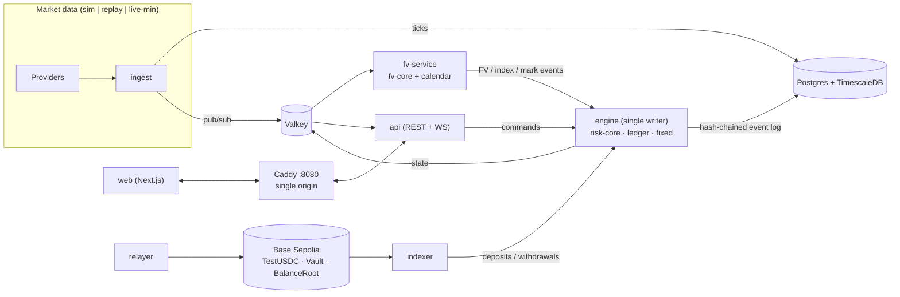
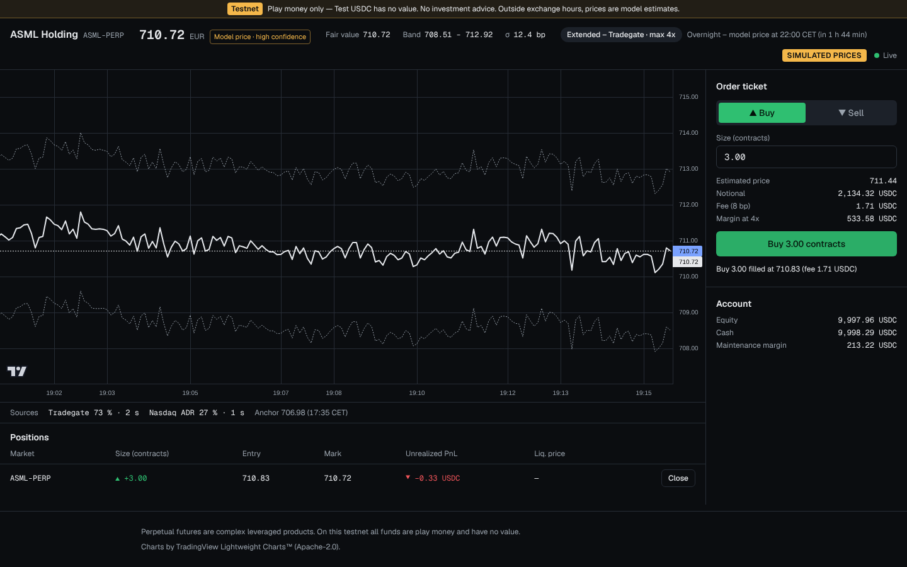

# EuroEdge

USDC-settled perpetual futures on European equities: a **public testnet with play money**, built around a 24/7 fair-value (FV) pricing engine. See [`PLAN.md`](PLAN.md) for the full plan and [`docs/adr/`](docs/adr/) for the decisions.

> **Testnet only.** Test USDC has no value and cannot be transferred except faucet→user and user↔vault. Nothing here is investment advice.

## Status

| Milestone                                       | State   |
| ----------------------------------------------- | ------- |
| M0 — scaffold, CI, infra, config, fixed-point   | ✅ done |
| M1 — thin vertical slice (ASML, sim, dev login) | next    |

## Architecture



The engine is event-sourced and deterministic: it never reads the wall clock, all money is bigint fixed-point (`packages/fixed`), and replaying the log reproduces state bit for bit (ADR-0001, ADR-0002).

## Repository layout

```
apps/       web · engine · fv-service · ingest · api · relayer · indexer · bots · backtest
packages/   shared · fixed · db · service-kit · ui   (fv-core, risk-core, ledger, calendar, execution, data-adapters arrive with their milestones)
config/     markets.yaml · windows.yaml · calendars/
docs/       adr/ · methodology/ · research/ui/ · versions.md
infra/      caddy/ (deploy configs later)
```

Workspace packages export TypeScript source. Node 24 runs services directly via native type stripping, so there is no build step for libraries (ADR-0011).

## Prerequisites

- Node **24.22.1** (`.nvmrc`) and pnpm **12.15.0** (`corepack enable` or `npm i -g pnpm@12.15.0`)
- Docker with Compose v2

## Setup

```bash
cp .env.example .env        # defaults: DATA_TIER=sim, DEV_LOGIN=false
pnpm install
pnpm hooks:install          # lefthook: prettier + commitlint
pnpm infra:up               # TimescaleDB, Valkey, Caddy (waits until healthy)
pnpm db:migrate
pnpm dev                    # all services + web
```

Open **http://localhost:8080**. Caddy is the single origin: `/api/*` and `/ws` go to the api service, everything else to the web app (ADR-0012). Service health is at `http://localhost:<port>/health`, with ports 4000–4060 (see `.env.example`).

## Try the M1 terminal

```bash
cp .env.example .env && sed -i 's/^DEV_LOGIN=false/DEV_LOGIN=true/' .env
pnpm install && pnpm infra:up && pnpm db:migrate
pnpm --filter @euroedge/web build && scripts/stack.sh start
# open http://localhost:8080/en/trade → "Start with play money"
scripts/stack.sh stop
```



## Everyday commands

| Command                        | What it does                                                             |
| ------------------------------ | ------------------------------------------------------------------------ |
| `pnpm test`                    | all unit/property tests (per package, via Turborepo)                     |
| `pnpm lint` / `pnpm typecheck` | ESLint 10 (type-aware) / `tsc` per package                               |
| `pnpm build`                   | builds the web app                                                       |
| `pnpm format`                  | Prettier                                                                 |
| `pnpm check:guards`            | DEV_LOGIN / DATA_TIER guard (also runs in CI)                            |
| `FC_NUM_RUNS=1000 pnpm test`   | property tests at CI strength; reproduce a failure with `FC_SEED=<seed>` |

The db integration test runs when `DATABASE_URL` is set (it is, via `.env`).

## Configuration rules

- Every setting is an env var, validated by zod at start-up (`@euroedge/shared/config`).
- `DATA_TIER` is `sim` (default), `replay` or `live-min`. In `sim` and `replay`, every price carries a "SIMULATED PRICES" watermark, and the leaderboard and accuracy page are off.
- Paid data APIs are never called without keys.
- `DEV_LOGIN=true` is refused unless `DATA_TIER=sim` and `DEPLOY_ENV` is `local` or `ci`. Enforced by the runtime config loader, the web build and CI.

## Backtest

```bash
pnpm --filter @euroedge/backtest start -- --help
```

Backtests run from M3 onwards. They import `fv-core` and `risk-core` directly, with no duplicated maths.

## Contracts

Foundry contracts (TestUSDC, Vault, BalanceRoot) for Base Sepolia arrive in M5. Deployment addresses are written to `packages/shared/deployments/84532.json`.

## Contributing

See [`CONTRIBUTING.md`](CONTRIBUTING.md): one task per branch and PR, conventional commits, and tests with every change. **Changes to FV, mark, funding, margin, ledger or contract maths need explicit founder review before merge.**

## Notices

Charts use TradingView Lightweight Charts™ (Apache-2.0). Fonts: Geist (SIL OFL 1.1).
